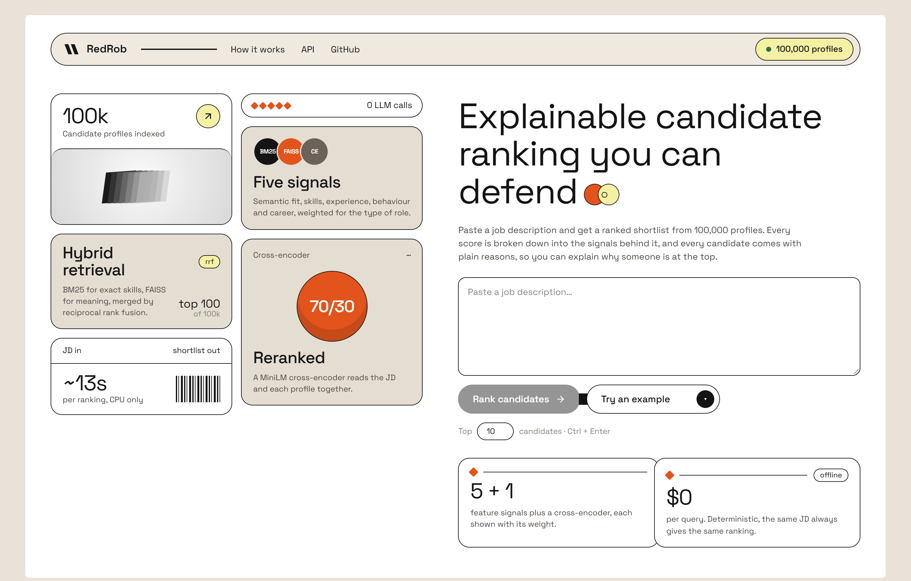
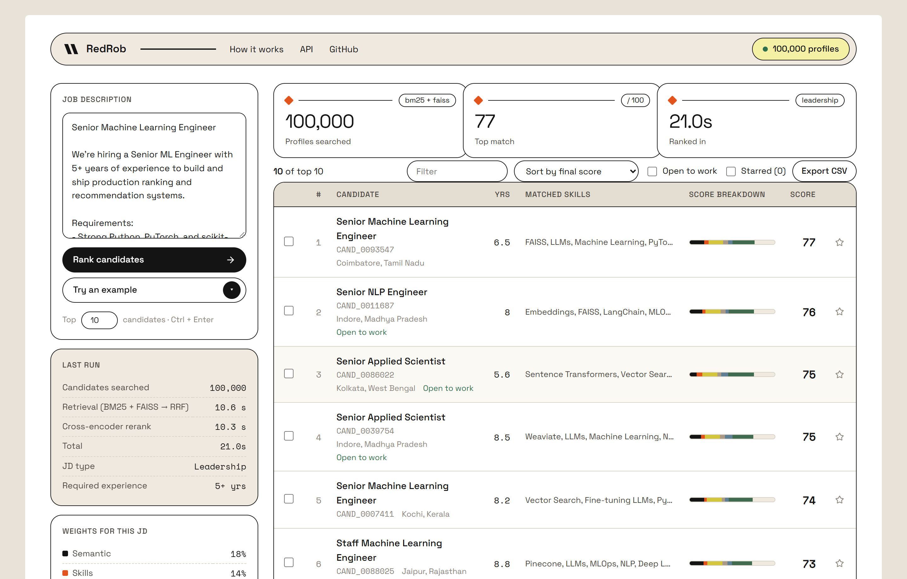
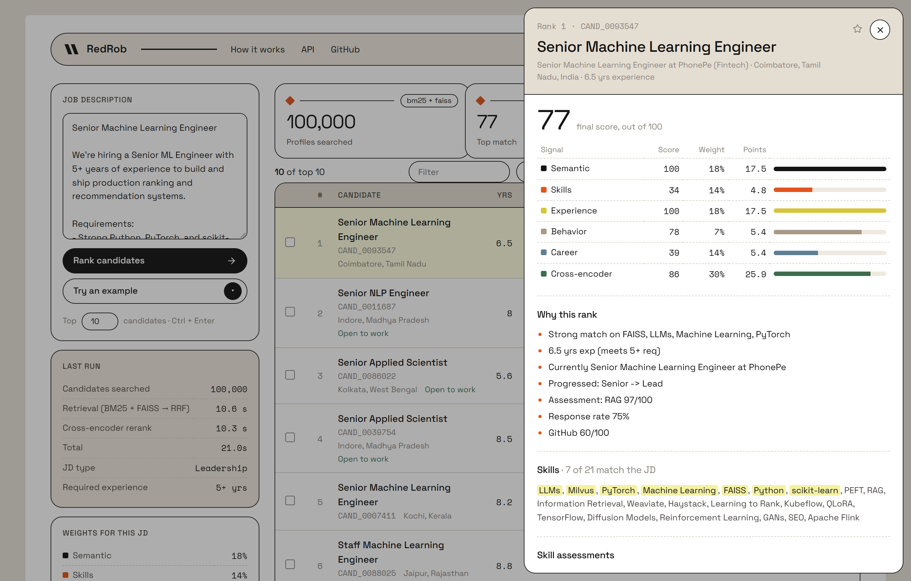
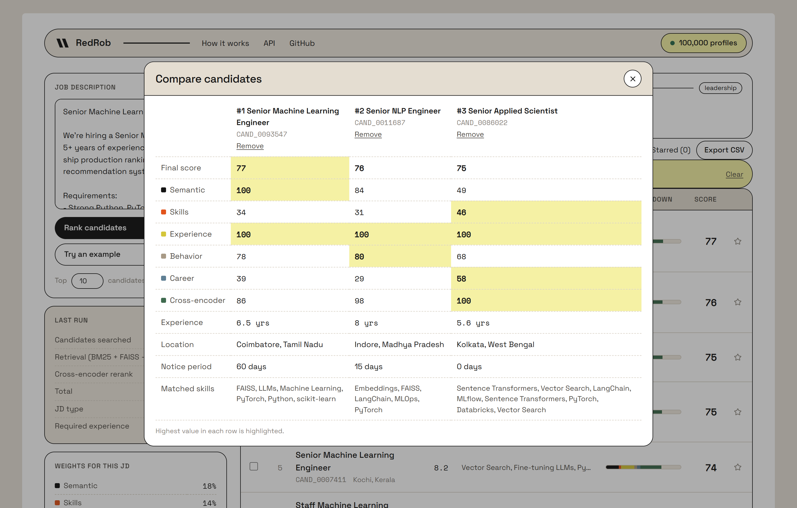
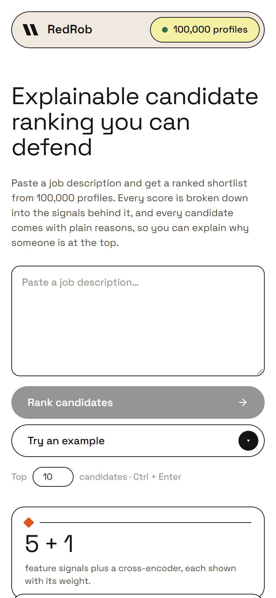

# REDROB AI

**An explainable candidate-ranking system: from a job description to a ranked shortlist out of 100,000 profiles, with no LLM in the loop.**

Recruiters get a ranked list all the time. What they rarely get is a reason. A model says someone is a
91% match and nobody can tell you why, so the list is hard to trust and impossible to defend to a hiring
manager. RedRob tries to rank candidates in a way you can explain, step by step.

It takes a job description, finds likely matches with keyword search (BM25) and semantic search (FAISS),
merges the two lists with Reciprocal Rank Fusion, scores the top 100 on five signals with weights tuned to
the type of role, and re-orders them with a cross-encoder. Every score in the UI is broken down into the
signals behind it, and every candidate comes with plain-language reasons.



## Design decisions

1. **No LLM in the ranking pipeline.** Results are deterministic (the same JD always gives the same ranking),
   cost $0 per query, run offline, and every number can be traced back to a formula. An LLM would have been
   easier to bolt on and much harder to explain.
2. **Two retrievers, not one.** BM25 catches exact skill names ("FAISS", "Kubernetes"); embeddings catch meaning
   ("vector search" ≈ "Milvus"). RRF merges them without having to calibrate their very different score scales.
3. **CPU only.** MiniLM embeddings, a flat FAISS index and a small cross-encoder, all run on a laptop.

## Architecture (short version)

```
                    ┌─> BM25 (top 75) ──┐
 Job description ──>│                   ├─> RRF fusion ──> top 100 ──> 5 feature signals ──> cross-encoder ──> ranked list
   (JD parser)      └─> FAISS (top 75) ─┘   1/(60+rank)              (JD-aware weights)     (70/30 blend)   + reasons
                                                                                                                │
                                                                         FastAPI  /api/rank ──> React UI  <─────┘
```

## Stack

| Layer          | Tool                                                         |
|----------------|--------------------------------------------------------------|
| JD parsing     | regex + a 77-skill dictionary (`preprocessing/jd_parser.py`)  |
| Keyword search | BM25 (own implementation, k1 = 1.5, b = 0.75)                 |
| Semantic search| `all-MiniLM-L6-v2` sentence embeddings + FAISS `IndexFlatIP`  |
| Fusion         | Reciprocal Rank Fusion, `score += 1 / (60 + rank)`            |
| Scoring        | skill ontology, merged career-history years, title progression, platform signals |
| Weights        | 5 profiles picked from the JD: leadership, senior technical, specialist, mid-level, junior |
| Re-ranking     | `cross-encoder/ms-marco-MiniLM-L-6-v2`, blended 70% features / 30% cross-encoder |
| API            | FastAPI (warms data, indexes and models once at startup)     |
| Frontend       | React 19 + Vite, no UI library                               |

## Data

| Source | What | Scope |
|---|---|---|
| India Runs Data & AI Challenge | anonymised candidate profiles: career history, skills with proficiency and endorsements, education, platform signals (response rate, interview completion, GitHub activity, offers, skill assessments) | 100,000 candidates, 487 MB JSONL |

## The five signals

| Signal | How it is computed |
|---|---|
| **Semantic** | the candidate's RRF score, normalised against the best in the top 100 |
| **Skills** | each JD skill matched through an alias ontology (e.g. FAISS ↔ Milvus, Pinecone, Qdrant), weighted by proficiency and endorsements |
| **Experience** | years from career history with overlapping jobs merged, divided by the JD's requirement (capped at 1) |
| **Behaviour** | recruiter response rate, interview completion, GitHub activity, recruiter saves, offer acceptance, skill-assessment average |
| **Career** | highest seniority level reached, plus bonuses for progression and tenure |

The weights move with the JD: a leadership JD puts more on experience and career, a junior JD more on skills.
The final score is `0.7 × weighted features + 0.3 × cross-encoder`, and the UI shows each part.

## What the UI does

- **Rank:** paste a JD (or load an example), choose how many to return, and watch the pipeline steps run.
- **Results table:** rank, title, location, years, ontology-matched skills, and a stacked bar showing how many
  points each signal contributed to the final score. Filter, sort by any signal, star, export to CSV.
- **Candidate panel:** score table (signal × weight = points), "why this rank", skills with JD matches
  highlighted, assessments, platform signals, experience and education.
- **Compare:** up to three candidates side by side, with the best value in each row highlighted.

| Results | Candidate panel |
|---|---|
|  |  |
| Top 10 of 100,000 for a Senior ML Engineer JD. The bar shows each signal's share of the score. | Every score is broken down; skills that matched the JD are highlighted. |

| Compare | Phone |
|---|---|
|  |  |

## Results at a glance

Measured on a Windows laptop (CPU only) with the built-in Senior ML Engineer JD.

| Question | Result |
|---|---|
| Who comes out on top? | Senior ML Engineer, Senior NLP Engineer, Senior Applied Scientist, Senior Applied Scientist, Senior ML Engineer, Staff ML Engineer |
| Does the API reproduce the submission? | Yes. `/api/rank` returns the same top IDs and scores as `outputs/submission.csv` (0.825, 0.8086, 0.7825, …) |
| Before vs after wiring the full pipeline | The old 50-profile path without the cross-encoder put a Graphic Designer and an HR Manager first for the same JD |
| Time per query (warm) | about 13 s: retrieval about 8–11 s, cross-encoder about 3–5 s |
| Startup | about 80 s to load 100k profiles, both indexes and both models |
| Cost per query | $0, no external calls |

## Running it

You need Python 3.12+ and Node 20+. Put the challenge data in
`[PUB] India_runs_data_and_ai_challenge/India_runs_data_and_ai_challenge/candidates.jsonl`.

```bash
pip install -r requirements.txt
cd frontend && npm install && cd ..

# first run only: builds BM25 + FAISS indexes for all 100k profiles (a few minutes)
# and writes outputs/submission.csv
python generate_submission.py

# API + UI together (Windows)
start_dev.bat

# or separately
python -m uvicorn api.app:app --port 8000
cd frontend && npm run dev
```

| Service   | URL                         |
|-----------|-----------------------------|
| **UI**    | **http://localhost:5173**   |
| API docs  | http://localhost:8000/docs  |
| Health    | http://localhost:8000/api/health |

The UI says "Loading models…" until the API has finished warming up.

## Project layout

| Path | What |
|---|---|
| `generate_submission.py` | the full pipeline: indexes, hybrid search, scoring, cross-encoder, CSV/XLSX output |
| `api/app.py` | FastAPI wrapper around `generate_submission.rank()` |
| `frontend/` | React UI |
| `preprocessing/` | JD parser, profile text builder |
| `ranking/` | dynamic weights, earlier ranker and cross-encoder experiments |
| `retrieval/` | earlier BM25 / FAISS / hybrid retrieval modules (used by `main.py` on the 50-profile sample) |
| `features/`, `reasoning/` | feature scorers and reasoning used by `main.py` |
| `evaluation/` | NDCG / precision metrics |

## Project status

**Working end to end** on the full 100k dataset, from JD to explained shortlist in the browser.

**Limits, honestly:** BM25 is pure Python and scans every document, so it is most of the 13 s per query
(an inverted index would cut that to about a second without changing the scores). The API keeps the whole
dataset in memory (a few GB). The JD parser is regex-based and sometimes picks up a skill that is only
mentioned in passing. There is no labelled ground truth for the full dataset, so ranking quality here is
judged by inspection, not by a measured NDCG.
